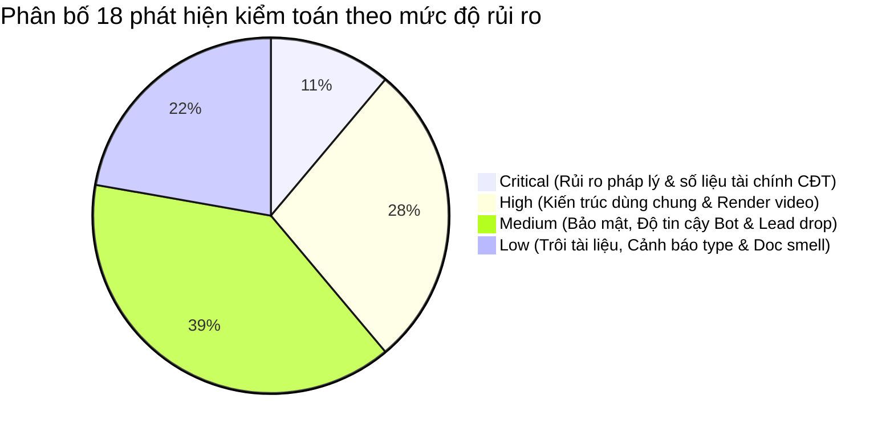
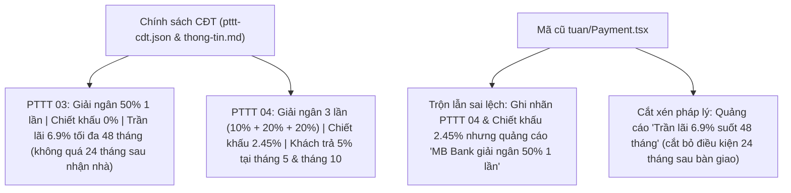
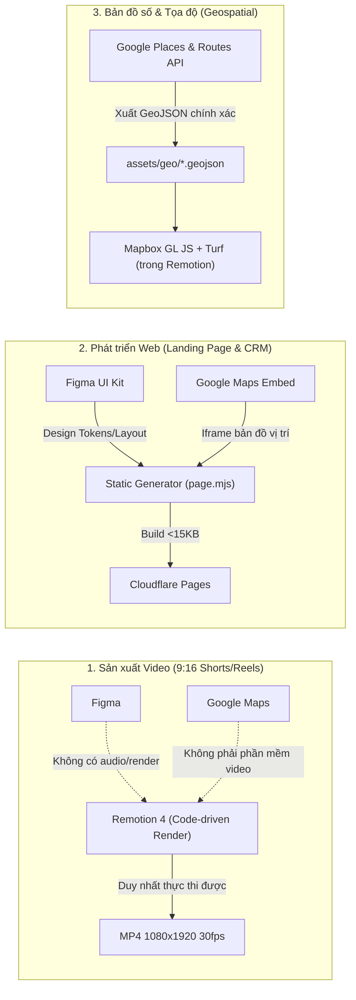
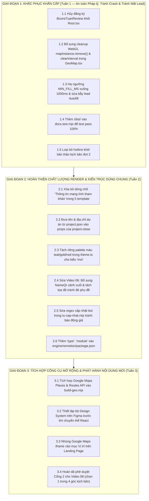

# BÁO CÁO KIỂM TOÁN HỆ THỐNG THÔNG TIN (CISA AUDIT REPORT)
**Dự án:** Bcons Central Park Automation Pipeline (`MarzTruong/bcons`)  
**Tiêu chuẩn áp dụng:** ISACA CISA (5 Domains) + OWASP Security Controls + Phân tích pháp lý số liệu BĐS Việt Nam (Luật Bảo vệ Dữ liệu Cá nhân 2025, Nghị định 356/2025/NĐ-CP, Nghị định 91/2020/NĐ-CP, Luật Kinh doanh BĐS)  
**Phương pháp kiểm toán:** Kiểm toán hộp trắng (White-box Source Code Audit), tuân thủ nguyên tắc tuyệt đối không can thiệp hay sửa đổi mã nguồn (`read-only`), đối chiếu chéo độc lập giữa hồ sơ quản trị dự án (`CLAUDE.md`, `DESIGN.md`, `PRODUCT.md`, `NOTES.md`), chính sách CĐT (`pttt-cdt.json`, `thong-tin.md`) và mã nguồn thực thi (`engine/`, `du-an/`).

---

## 1. BẢNG TỔNG HỢP KẾT QUẢ KIỂM TOÁN (EXECUTIVE DASHBOARD)

### 1.1 Tổng quan điểm đánh giá theo 5 Miền ISACA CISA

| Miền kiểm toán (ISACA CISA Domain) | Trọng số | Điểm đánh giá | Trạng thái tuân thủ | Rủi ro chính ghi nhận |
|---|:---:|:---:|:---:|---|
| **Domain 1: Quy trình Kiểm toán & Cổng kiểm soát (Auditing Process & Gates)** | 20% | **9.2 / 10** | **Rất tốt (Cao)** | Hệ thống 4 cổng kiểm soát chặt chẽ; `check-spec.mjs` chưa quét chữ cấm trên `spec.json`; Video 02 thiếu `caption.md`. |
| **Domain 2: Quản trị & Kiến trúc CNTT (Governance & Multi-Project Architecture)** | 20% | **8.0 / 10** | **Khá (Đạt)** | Tách tầng `engine/` và `du-an/` tốt; 5 template `project-close` trong `engine/` bị hardcode tên và địa chỉ dự án; vi phạm quy tắc No-AI-Slop. |
| **Domain 3: Vận hành, Dựng hình & Kiểm thử (Development, Render Determinism & Testing)** | 20% | **7.8 / 10** | **Cần khắc phục** | `GeoMap.tsx` rò rỉ WebGL context và `setInterval`; mẫu `"moi"` chập màu bản đồ; Video 06 mất QR và đè phụ đề; `docs.test.mjs` trượt trên git clone sạch. |
| **Domain 4: Vận hành & Dự phòng thảm họa (Operations, Bot Switcher & Resilience)** | 20% | **8.8 / 10** | **Tốt (Cao)** | Bot failover PC ⇄ Laptop qua Google Drive hoạt động tin cậy; Apps Script nuốt lead khi khách điền nhanh bằng Autofill (<3s); cảnh báo giả cập nhật bot. |
| **Domain 5: An toàn tài sản thông tin & Toàn vẹn số liệu (Security & Financial Integrity)** | 20% | **7.5 / 10** | **Cảnh báo đỏ (Mã cũ)** | **0 bí mật rò rỉ trên Git**. Thư mục mã cũ `src/tuan/*` trộn sai bản chất giải ngân PTTT 04/03, thiếu điều kiện trần lãi 6,9%, lộ SĐT trên video. |
| **ĐIỂM TRUNG BÌNH TOÀN DIỆN (CISA COMPOSITE SCORE)** | 100% | **8.26 / 10** | **Hạng B+ (Mạnh, cần xử lý các rủi ro đã nhận diện)** | Toàn bộ 18 khiếm khuyết đã được xác định nguyên nhân gốc rễ và lập lộ trình khắc phục 3 giai đoạn. |

### 1.2 Phân bố 18 phát hiện kiểm toán theo mức độ rủi ro (Risk Distribution)



| Cấp độ rủi ro | Số lượng | Danh mục phát hiện chính |
|---|:---:|---|
| **CRITICAL** | **2** | **F-01**: Trộn lẫn PTTT 04 và 03 trong `src/tuan/Payment.tsx`; **F-02**: Quảng cáo sai sự thật, thiếu VAT/KPBT và hardcode SĐT trong `src/tuan/*`. |
| **HIGH** | **5** | **CQ-01**: Rò rỉ WebGL context và timer trong `GeoMap.tsx`; **CQ-02**: Chập màu bản đồ và lệch phong cách trong `theme.ts`; **CQ-03**: Hardcode thông tin dự án trong 5 template `project-close`; **CQ-05/F-03**: Video 06 mất QR, đè chữ phụ đề và hotline trên video đợt 2; **CQ-11**: `docs.test.mjs` lỗi trên git checkout sạch. |
| **MEDIUM** | **7** | **F-04**: `shell: true` với tham số chưa kiểm tra trong `render-drive.mjs`; **F-05**: Nhận diện sai lỗi cập nhật bot (`tu-cap-nhat.mjs`); **F-06/CQ-17**: Nuốt lead im lặng trên Landing do `MIN_FILL_MS` và `no-cors`; **F-07**: Lỗ hổng bỏ sót đuôi CSV trong hook `kiem-commit.mjs`; **CQ-04**: So khớp từ nhấn (`nhan`) dễ ăn nhầm chuỗi con; **CQ-06**: Giới hạn tọa độ `worldWithHole` chỉ hỗ trợ miền Nam; **CQ-12**: Thiếu `"type": "module"` trong `engine/remotion/package.json`. |
| **LOW** | **4** | **F-08/CQ-18**: Trôi lệch tài liệu hướng dẫn landing và trích dẫn pháp lý; **CQ-07**: Tải GeoJSON lặp tuần tự không cache; **CQ-08/10**: Import mặc định còn sót và component `Hook.tsx` mount thừa; **CQ-15**: Các script geo chưa hỗ trợ cờ `--du-an`. |

---

## 2. CHI TIẾT ĐÁNH GIÁ THEO 5 MIỀN CISA (ISACA CISA DOMAINS)

### DOMAIN 1: QUY TRÌNH KIỂM TOÁN HỆ THỐNG THÔNG TIN (THE PROCESS OF AUDITING INFORMATION SYSTEMS)
*Điểm đánh giá: **9.2 / 10** — Mức độ trưởng thành: Tự động hóa cao (Automated & Enforced)*

#### 1.1 Cơ chế kiểm soát tự động 4 Cổng (Four-Gate Verification Pipeline)
Quy trình sản xuất nội dung video tuân thủ nghiêm ngặt 4 cổng kiểm soát chất lượng độc lập được định nghĩa tại `CLAUDE.md:27-32` và `.claude/skills/bcons-video/SKILL.md`:
1. **Cổng 1 (Nghiên cứu & Đối chiếu nguồn tin):** Lệnh gọi Gemini Search (`gemini.mjs`) tạo báo cáo thô tại `nguon/gemini/<date>-<slug>.md`. Claude độc lập rà soát từng đường link nguồn, lập báo cáo `-KIEM.md` trước khi chốt góc làm video.
2. **Cổng 2 (Kịch bản, Phân cảnh Spec, Caption & Storyboard):** Tạo `kich-ban.md` có bảng `## Bảng nguồn`. File `spec.json` và `caption.md` được tạo ở trạng thái `draft`. Công cụ `storyboard.mjs` chụp 3 khung hình nửa tỷ lệ (`scale: 0.5`) cho mỗi cảnh dựa trên hàm ước tính thời lượng (`estimateTimestamps`) để phê duyệt trực quan trước khi tốn chi phí giọng đọc.
3. **Cổng 3 (Sinh giọng đọc & Bắt buộc duyệt nguồn):** Hàm `prepareRun()` tại `spec-tools.mjs:246-266` bắt buộc:
   - `spec.status === "approved"`.
   - 100% `sourceId` xuất hiện trong `spec.json` phải tồn tại trong bảng `## Bảng nguồn` của `kich-ban.md` kèm đường dẫn `http(s)://` hợp lệ.
   - Toàn bộ file ảnh, GeoJSON phải tồn tại và nằm trong tọa độ Việt Nam (`lng: 102..110`, `lat: 8..24`).
   - Nếu vi phạm, tiến trình ném lỗi và từ chối nạp API key của ElevenLabs.
4. **Cổng 4 (Dựng hình, Khóa băm SHA-256 & Phát hành Telegram):**
   - Video được dựng thông qua `render-drive.mjs`. Sau khi render xong, `caption-cli.mjs` ghi nhận hàm băm mật mã SHA-256 của nội dung bài viết (`noiDungSha256`) và file video hoàn chỉnh (`videoSha256`).
   - Script xuất bản `send-telegram.mjs:32-48` đối chiếu mã băm thực tế trước khi gửi. Nếu phát hiện video hoặc caption bị can thiệp sau thời điểm phê duyệt, tiến trình lập tức từ chối gửi bài.

#### 1.2 Kiểm soát chuẩn hóa hiển thị số và ký hiệu (Inverse Text Normalization - ITN)
- Module `itn.mjs` và các hàm `checkShownSymbols()`, `checkSpelledNumbers()` trong `spec-tools.mjs:214-234` ngăn chặn triệt để tình trạng hiển thị chữ số kiểu văn nói trên màn hình video:
  - Chặn các cụm từ viết chữ: *"chín mươi phần trăm"*, *"hai tỷ"*, *"quý hai"*, *"mười phần trăm một năm"*.
  - Bắt buộc chuẩn hóa ký hiệu: `%`, `tỷ`, `tr`, `m²`, `km`, `ha`.

#### 1.3 Khiếm khuyết kiểm soát cần hoàn thiện (Control Deficiencies)
- **Thiếu quét từ cấm trên trường dữ liệu của `spec.json`:** Hàm `checkCaption` (`caption.mjs:96-131`) quét các cụm từ cấm như *"cam kết lợi nhuận"*, *"chắc chắn tăng giá"*, *"sắp hết hàng"*, số điện thoại trên `caption.md`, nhưng **chưa quét trên các trường `title`, `markup`, `cards`, `message` trong `spec.json`**.
- **Video 02 thiếu file caption:** Phân cảnh `du-an/bcons-central-park/video/02-dong-nai-ha-tang-map/` đã có spec `approved` và âm thanh hoàn chỉnh nhưng hoàn toàn thiếu file `caption.md`.

---

### DOMAIN 2: QUẢN TRỊ CNTT & KIẾN TRÚC HỆ THỐNG ĐA DỰ ÁN (GOVERNANCE & MULTI-PROJECT ARCHITECTURE)
*Điểm đánh giá: **8.0 / 10** — Mức độ trưởng thành: Khá (Cần loại bỏ rò rỉ dữ liệu tầng chung)*

#### 2.1 Kiến trúc phân tầng (Two-Layer Architecture)
- Hệ thống áp dụng mô hình phân tách rõ ràng giữa tầng dùng chung (`engine/`) và tầng dữ liệu nghiệp vụ theo dự án (`du-an/<mã>/`):
  - `config.json` chỉ định dự án hiện hành (`"duAnDangBan": "bcons-central-park"`).
  - Module `engine/remotion/scripts/project.mjs` tự động tìm kiếm thư mục dự án, thư mục đồng bộ Google Drive và nạp cấu hình hợp lệ (`readProjectConfig`).
  - Cung cấp sẵn mẫu khởi tạo dự án mới (`du-an/_mau/`) và script giàn giáo `tao-du-an.mjs`.

#### 2.2 Rò rỉ dữ liệu dự án vào tầng dùng chung (`engine/`)
Quy tắc kiến trúc cốt lõi tại `CLAUDE.md:18` quy định: *"engine/: code dùng chung, không chứa số liệu dự án"*. Tuy nhiên kiểm toán phát hiện sự vi phạm cấu trúc nghiêm trọng:
1. **Hardcode thông tin dự án trong 5 template `project-close`:**
   - Các file `ProjectClose.tsx:48-51, 70-76`, `Moi.tsx:174-177`, `TapChi.tsx:150-151`, `BangLs.tsx:180-181`, `BanVe.tsx:290-295` đều hardcode chuỗi ký tự `"Bcons Central Park"` và địa chỉ `"236 Phan Trung, Tam Hiệp, Biên Hòa, Đồng Nai"`.
   - Khi chuyển đổi sang dự án mới (ví dụ: `bcons-newsky`), cảnh kết thúc video vẫn bị in tên và địa chỉ của Bcons Central Park. Ngoài ra, địa chỉ chuẩn hóa hành chính năm 2026 trong `project.json:5` là `"236 Phan Trung, phường Tam Hiệp, TP. Đồng Nai (Biên Hòa)"`, lệch so với chuỗi hardcode.
2. **Hardcode trong các script địa lý và CRM:**
   - Các file `build-geo.mjs:12-17`, `geo-fetch.mjs:26-32`, `geo-derive.mjs:34-79` và `Code.gs:84,96` (`"🔥 KHÁCH MỚI – landing Bcons Central Park"`) chứa dữ liệu gắn chặt với dự án hiện tại thay vì nạp từ cấu hình `project.json`.

#### 2.3 Vi phạm quy tắc loại bỏ ngôn từ máy viết (No-AI-Slop Compliance)
- Commit `5978007` (08/11/2026) bổ sung quy tắc cấm ngặt nghèo tại `CLAUDE.md:43`:
  > *"Câu kiểu 'nội dung mang tính tham khảo' đọc ra là máy viết, không đưa lên trang/video."*
- Tuy nhiên, cả 5 template kết thúc video (`ProjectClose.tsx:125`, `Moi.tsx:188`, `TapChi.tsx:162`, `BangLs.tsx:197`, `BanVe.tsx:318`) và file `06-tai-thiet-kcn-bien-hoa-1/spec.json:507` vẫn in dòng chữ `"Thông tin mang tính tham khảo"` ở chân màn hình.

---

### DOMAIN 3: VẬN HÀNH DỰNG HÌNH & HIỆU NĂNG RENDER (DEVELOPMENT, RENDER DETERMINISM & TESTING)
*Điểm đánh giá: **7.8 / 10** — Mức độ trưởng thành: Cần khắc phục kỹ thuật*

#### 3.1 Rò rỉ tài nguyên WebGL & Timer trong `GeoMap.tsx` (Nguy cơ Crash Render)
- **Cơ chế rò rỉ:** Trong `GeoMap.tsx:412-416`, hàm dọn dẹp (cleanup) của `useEffect` khởi tạo Mapbox GL chỉ gán `cancelled = true` mà **không hề gọi `mapInstance.remove()`**. Tại dòng 433, lệnh `setInterval(() => map.triggerRepaint(), 1000)` được gọi trong `useEffect([frame, map, data])` mà **không có `clearInterval(retry)` trong return cleanup**.
- **Tác động tích tụ ngữ cảnh:** Video `06-tai-thiet-kcn-bien-hoa-1` có **4 cảnh `geo-map` liên tiếp**. Trong khi đó, `remotion.config.ts:15` kích hoạt cơ chế nạp trước khung hình `Config.setDefaultPremountInSeconds(2)` (mount trước 60 frame). Điều này khiến 4 phiên bản Mapbox GL WebGL tồn tại đồng thời trong bộ nhớ RAM/VRAM của Chromium headless. Trên các máy trạm không có card đồ họa rời chuyên dụng, việc vượt ngưỡng 8–16 WebGL context của Chromium sẽ gây crash tiến trình render giữa chừng (`Out of Memory` hoặc `Context Lost`).
- Khi người dùng kéo thanh trượt (scrubbing) trong Remotion Studio, hàng chục timer `setInterval` sẽ bị rò rỉ liên tục, làm suy giảm nghiêm trọng FPS của trình duyệt.

#### 3.2 Lệch chuẩn màu sắc & mất độ tương phản trong phong cách `"moi"`
- Tại `theme.ts:141-144`, khi video dùng phong cách mới (`style === "moi"`, áp dụng cho toàn bộ video 01–07):
  ```typescript
  teal: m.accent, gold: m.accent, red: m.accent
  ```
- **Hệ quả trực quan:** 
  1. Toàn bộ các mốc địa lý, tuyến đường và ranh giới quy hoạch trong `GeoMap.tsx` và `RouteMap.tsx` vốn được mã hóa màu riêng biệt (`teal` cho tiện ích, `gold` cho giao thông, `red` cho ranh giới dự án) bị **chập thành một màu duy nhất** (`m.accent`).
  2. Ở phân kỳ Bản tin sáng (`bantin`, áp dụng cho video 02 và 05 với `so % 3 === 2`), `m.text` là màu xanh đen `#0b1f3a`, trong khi `stroke` bị gán cứng `#000000`. Khi hiển thị trên nền ảnh vệ tinh tối của Mapbox (`satellite-streets-v12`), các nhãn địa danh biến thành **chữ xanh đen viền đen trên nền ảnh tối**, gây chìm màu và không thể đọc được.

#### 3.3 Khuyết tật phân cảnh Video 06 (`06-tai-thiet-kcn-bien-hoa-1`)
1. **Mất hoàn toàn mã QR và tên tư vấn viên:** Cảnh 4 của Video 06 sử dụng `template: "geo-map"` (thay vì `project-close`). Cơ chế watermark trong `Watermark.tsx:96` tắt mã QR góc ở cảnh cuối (`if (s.id === lastId) return null;`) vì mặc định cảnh cuối sẽ có banner `<NameQr>`. Nhưng `GeoMap.tsx` không hề render `<NameQr>`, dẫn đến cảnh kết thúc của Video 06 hoàn toàn không có mã QR và không có tên tư vấn viên.
2. **Đè chữ phụ đề trực tiếp:** Khung thông điệp `props.message` của `GeoMap.tsx:521-539` hiển thị ở tọa độ Y ≈ 1300..1495, đè trực tiếp lên vị trí render phụ đề tự động của `Captions.tsx:42` (tọa độ Y = 1400..1760).
3. **Gắn nhãn minh họa sai quy cách:** `scene4.props.image.label` ghi chữ `"Bcons Central Park"` với cỡ chữ 52px ở góc trên thay vì nhãn nhỏ `"Hình ảnh minh họa"`, trong khi dòng ghi chú hợp pháp lại bị đẩy xuống chân trang (`note`), vi phạm `CLAUDE.md:48`.

#### 3.4 Lỗi kiểm thử tự động trên máy mới (`docs.test.mjs`)
- Lệnh chạy test `node --test engine/automation/docs.test.mjs` thất bại ngay lập tức trên bản git clone sạch:
  ```text
  AssertionError [ERR_ASSERTION]: actual: ['docs/huong-dan-landing.md → engine/landing/dist/bcons-central-park'], expected: []
  ```
- **Nguyên nhân:** File `docs/huong-dan-landing.md:29` trích dẫn đường dẫn `engine/landing/dist/bcons-central-park`. Thư mục `dist/` nằm trong `.gitignore` và chỉ được sinh ra sau khi chạy lệnh build landing page. Tuy nhiên biểu thức chính quy bỏ qua đường dẫn sinh tự động tại dòng 40 của `docs.test.mjs` (`/\.env$|\/out\/|node_modules|\.am-thanh|audio-test/`) quên không khai báo `/\/dist\//`.

---

### DOMAIN 4: VẬN HÀNH HỆ THỐNG & ĐỘ BỀN DỮ LIỆU (OPERATIONS & RESILIENCE)
*Điểm đánh giá: **8.8 / 10** — Mức độ trưởng thành: Tốt (Cần khắc phục bẫy rớt lead)*

#### 4.1 Cơ chế dự phòng chuyển đổi máy chủ tự động (PC ⇄ Laptop Failover)
- Module `engine/remotion/scripts/bot/may.mjs` thiết lập cơ chế giám sát nhịp tim (heartbeat) giữa hai máy trạm thông qua các file trạng thái `may-<hex>.json` và hàng đợi lệnh `lenh.json` trên Google Drive.
- Máy chạy (`"chay"`) gửi heartbeat định kỳ; nếu máy chờ (`"cho"`) phát hiện máy chính mất kết nối hoặc không cập nhật quá 3 phút, máy chờ sẽ tự động kích hoạt quyền điều khiển và nhận lệnh từ Telegram, đảm bảo tính liên tục trong vận hành.

#### 4.2 Nhận diện sai lỗi cập nhật Bot (False-Positive Alert)
- Tại `tu-cap-nhat.mjs:16`, hàm kiểm tra log cập nhật sử dụng regex:
  ```javascript
  ok: !/\bLOI\b|error|fatal|lỗi/i.test(tomTat)
  ```
- File kịch bản Windows `capnhat.cmd:33` ghi thông tin commit mới nhất vào log bằng lệnh `git log -1 --format="Ban hien tai: %%h %%s"`. Nếu lập trình viên commit với thông điệp có chứa từ *"lỗi"* (ví dụ: *"Sửa lỗi tính bảng giá PTTT"*), regex trên sẽ hiểu nhầm là tiến trình git pull bị lỗi, phát tín hiệu cảnh báo đỏ lên Telegram và bật cờ `vuaCapNhatLoi = true`.

#### 4.3 RỦI RO MẤT DỮ LIỆU KHÁCH HÀNG: Silent Lead Drop trên Landing Page
- **Cơ chế chống bot của Apps Script:** File `engine/landing/apps-script/Code.gs:45` cài đặt bẫy thời gian tối thiểu để điền form là 3 giây (`MIN_FILL_MS = 3000`). Nếu dữ liệu gửi lên có `p.t < 3000`, Apps Script xem đó là spam bot, trả về `{ ok: true }` nhưng **hoàn toàn không lưu vào Google Sheet và không bắn thông báo Telegram**.
- **Xung đột với hành vi người dùng di động:** Trên điện thoại thông minh, người dùng thường xuyên sử dụng tính năng **Google Autofill (Tự động điền)** hoặc iCloud Keychain. Khi bấm vào ô nhập, hệ thống tự điền tên và số điện thoại, người dùng chỉ mất từ 1–2 giây để nhấn nút *"Nhận bảng giá"*.
- **Hậu quả mất lead âm thầm:** Do `engine/landing/client.js:96` gửi request bằng `fetch(D.formUrl, { method: "POST", mode: "no-cors", ... })`, trình duyệt nhận về opaque response (`status === 0`) và ngay lập tức ẩn form, hiển thị thông báo:
  > *"Đã nhận thông tin thành công. Em sẽ gửi bảng tính chi tiết qua Zalo trong vài phút."*
- Khách hàng tin rằng đã đăng ký thành công, nhưng tư vấn viên hoàn toàn không nhận được thông tin liên hệ. Đây là rủi ro rò rỉ chuyển đổi kinh doanh nghiêm trọng.

---

### DOMAIN 5: BẢO MẬT TÀI SẢN THÔNG TIN & TOÀN VẸN SỐ LIỆU TÀI CHÍNH (SECURITY, OWASP & FINANCIAL INTEGRITY)
*Điểm đánh giá: **7.5 / 10** — Mức độ trưởng thành: Cảnh báo đỏ tại thành phần mã cũ*

#### 5.1 Quản trị bí mật & An toàn kho lưu trữ Git: **10 / 10**
- Kiểm toán toàn diện lịch sử hơn 200 commit bằng các lệnh quét sâu (`git log --all --stat`, `git status --ignored -s`) xác nhận: **Tuyệt đối không có API key, file `.env`, file danh sách giá nội bộ (`bang-gia.csv`), hay bảng tính Master File Excel nào từng bị đưa lên GitHub**.
- Hệ sinh thái bảo vệ 3 lớp gồm:
  1. `.gitignore:1-21` loại trừ triệt để dữ liệu nhạy cảm.
  2. `.claude/settings.json` cấu hình hook tiền kiểm tra `PreToolUse`.
  3. `.githooks/pre-commit` kích hoạt script `kiem-commit.mjs` quét tên file và nội dung stage trước mỗi lượt commit.

#### 5.2 Bề mặt thực thi lệnh hệ thống (Command Injection Surface)
- Tại `engine/remotion/scripts/render-drive.mjs:39, 71-74`, tham số tên file xuất ra `rest[1]` (`file`) không được kiểm tra biểu thức chính quy (trong khi `name` được chặn bằng `assertName`). Biến `out` chứa `rest[1]` được truyền thẳng vào `spawnSync("npx", [...], { shell: true })`. Cần loại bỏ `shell: true` hoặc kiểm tra chặt chẽ `rest[1]` bằng regex `/^[a-z0-9._-]+\.mp4$/i`.
- Tại `render-drive.mjs:15`, hàm `process.loadEnvFile(".env")` được gọi ở đầu file trước khi gọi `prepareRun()`, đi ngược lại nguyên tắc kiểm tra điều kiện phê duyệt trước khi đọc biến môi trường.

#### 5.3 RỦI RO NGHIÊM TRỌNG: Sai lệch số liệu tài chính CĐT trong `src/tuan/*`
Thư mục mã nguồn cũ `engine/remotion/src/tuan/` (vẫn đang được khai báo hoạt động trong `Root.tsx:30-37` dưới tên composition `BconsTuanReview`) hoàn toàn đứng ngoài 4 cổng kiểm soát chất lượng và chứa hàng loạt sai phạm nghiêm trọng đối với chính sách bán hàng chính thức của Chủ đầu tư:



1. **Trộn lẫn PTTT 04 và PTTT 03 (`Payment.tsx:18-45, 180-218`):**
   - Video đặt tiêu đề cảnh là `"PTTT SỐ 4 · DÒNG TIỀN"` và nhận chiết khấu `2,45%`, nhưng nội dung lại quảng cáo: *"MB Bank giải ngân 50% 1 lần"*.
   - Theo công văn chính thức của Chủ đầu tư Bcons (`pttt-cdt.json:16-21` và `thong-tin.md:48-56`), **PTTT 04 giải ngân chia làm 3 đợt ngắt quãng (10% đợt 3 + 20% đợt 5 + 20% đợt 7)** xen kẽ với 2 đợt khách tự đóng 5% tại tháng thứ 5 và tháng thứ 10 sau khi ký HĐMB. Hình thức ngân hàng giải ngân 50% một lần là PTTT 03 (mà PTTT 03 thì **chiết khấu 0%**, không có chiết khấu 2,45%).
2. **Cắt bỏ điều kiện ràng buộc trần lãi suất 6,9%:**
   - Trong `Payment.tsx:190`, video quảng cáo *"Lãi suất trần 6,9%/năm suốt 48 tháng; CĐT chi trả 100% lãi vượt trần"*.
   - Tuy nhiên, thông báo CĐT quy định điều kiện kép bắt buộc: *"Hỗ trợ lãi suất tối đa 48 tháng nhưng không vượt quá 24 tháng kể từ ngày có thông báo bàn giao căn hộ; gói cố định tối đa 30 tháng tại MB Bank"*. Việc quảng cáo 48 tháng vô điều kiện vi phạm Luật Kinh doanh BĐS về cung cấp thông tin sai lệch về gói tài chính.
3. **Hardcode số điện thoại lên màn hình video:**
   - Số điện thoại cá nhân `0938.32.31.39` xuất hiện trực tiếp trên khung hình tại `src/tuan/Intro.tsx:36` và `src/tuan/Cta.tsx:65`. Điều này vi phạm lệnh cấm số điện thoại trên video tại `CLAUDE.md:40` và chính sách thuật toán phân phối của TikTok / Facebook Reels (quét OCR phát hiện SĐT sẽ bóp tương tác).
4. **Đưa ra các thông tin dự án chưa được kiểm chứng:**
   - `src/tuan/Intro.tsx:219` ghi *"Trường mầm non Bcons"* (vốn đã bị gắn nhãn cấm sử dụng trong `du-an/bcons-central-park/nguon/doi-chieu-gia-tri-du-an.md:13` do tài liệu CĐT chỉ phê duyệt nhà trẻ tại tầng 2).
   - Tuyên bố diện tích hầm `> 40.000 m²` (trong khi tổng diện tích khu đất chỉ là 27.455,7 m²).
   - `src/tuan/RadarMap.tsx:28-58` đưa ra thời gian di chuyển chưa kiểm chứng: *"Vincom 2 phút"*, *"Cù Lao Hiệp Hòa 3 tỷ USD sát vách"*.

---

## 3. MA TRẬN ĐÁNH GIÁ CÔNG CỤ: FIGMA & GOOGLE MAPS PLATFORM VS. REMOTION
*Giải đáp câu hỏi chiến lược kiến trúc từ người dùng: Có thể thay thế Remotion bằng Figma và Google Maps Platform cho bài toán biên tập video, phát triển web và bản đồ hay không?*



| Tiêu chí nghiệp vụ | Remotion 4 (Hệ thống hiện tại) | Figma (Plugin / REST API / MCP) | Google Maps Platform (Plugin / API) | Kết luận kiến trúc & Đề xuất hành động |
|---|---|---|---|---|
| **Dựng video ngắn có khớp giọng đọc ElevenLabs (Frame-accurate)** | **Xuất sắc (Bản chất cốt lõi).** Mỗi frame là một hàm toán học thuần túy `f(frame)`. Khớp chính xác từng từ từ `timestamps.json`, tự động tính camera Mercator, hiệu ứng karaoke và chuyển cảnh. CLI tự động hóa 100%. | **HOÀN TOÀN KHÔNG THỂ.** Figma là phần mềm thiết kế giao diện tĩnh (UI/Vector Canvas), không có timeline âm thanh, không đọc được dữ liệu JSON để căn chỉnh từng mili-giây âm thanh, không render được MP4 bằng CLI. | **HOÀN TOÀN KHÔNG THỂ.** Google Maps là dịch vụ dữ liệu và bản đồ, không phải công cụ dựng video hay ghép nhạc. | **BẮT BUỘC GIỮ REMOTION.** Không có bất kỳ công cụ nào trong hệ sinh thái trên có thể thay thế Remotion cho việc dựng video tự động. |
| **Thiết kế giao diện & Kiểu dáng phân cảnh (UI/UX Design)** | Code thẳng bằng CSS-in-JS và React inline. Tốn thời gian hình dung layout nếu chưa chạy Remotion Studio hoặc storyboard. | **XUẤT SẮC NHẤT.** Vẽ layout, thử nghiệm màu sắc, responsive di động, tạo component library cực nhanh. Hỗ trợ xuất mã CSS và Design Tokens. | Không áp dụng cho thiết kế giao diện đồ họa. | **BỔ SUNG FIGMA LÀM CÔNG CỤ THIẾT KẾ ĐẦU NGUỒN.** Dùng Figma để vẽ trước các mẫu cảnh mới (`MoiCompareBars`, `route-map`, thẻ căn hộ) trước khi chuyển thể thành code React. |
| **Phát triển Web Landing Page & Bảng tính tài chính** | Bộ sinh tĩnh `engine/landing/page.mjs` cho ra file HTML+CSS+JS dưới 15KB, chạy cực nhẹ trên Cloudflare Pages, tích hợp chung thuật toán tài chính `calc.mjs`. | Thiết kế giao diện landing page, kiểm tra trải nghiệm người dùng mobile, xuất hình ảnh SVG/WebP. Không tự chạy được logic tính lãi hay form lead. | Hỗ trợ nhúng bản đồ tương tác hiển thị vị trí dự án `236 Phan Trung` và các tiện ích xung quanh. | **GIỮ BỘ BUILD TĨNH HIỆN TẠI.** Bổ sung khung thiết kế Figma và nhúng Google Maps iframe vào mục Vị trí trên landing page. |
| **Dữ liệu & Hình ảnh Bản đồ số cho Video** | Dùng Mapbox GL JS + Overpass API (OSM). Thường xuyên bị lỗi timeout kết nối Overpass, thiếu dữ liệu điểm mốc (Aeon Mall phải chấm tọa độ giả định), đường cao tốc phải vẽ đường thẳng thô sơ. | Không áp dụng cho GIS hoặc dữ liệu địa lý. | **VÔ CÙNG MẠNH MẼ (Places API & Routes API).** Lấy chính xác tọa độ Aeon Mall Biên Hòa, tính đúng lộ trình lái xe thực tế (trả về polyline chuẩn) từ dự án tới Sân bay Long Thành. | **TÍCH HỢP GOOGLE MAPS LÀM TẦNG THU THẬP DỮ LIỆU (DATA INGESTION).** Dùng Google API trong `build-geo.mjs` để xuất ra file GeoJSON chuẩn, sau đó để Mapbox GL JS trong Remotion vẽ và tạo hoạt cảnh. |

---

## 4. BẢNG DANH MỤC 18 PHÁT HIỆN KIỂM TOÁN (CONSOLIDATED FINDINGS LOG)

| Mã ID | Mức độ | Miền CISA | Tệp tin & Dòng code vi phạm | Tóm tắt phát hiện & Rủi ro | Biện pháp khắc phục kiến nghị |
|:---:|:---:|:---:|---|---|---|
| **F-01** | **CRITICAL** | Domain 5 | `engine/remotion/src/tuan/Payment.tsx:18-45, 180-218` | **Trộn lẫn sai lệch PTTT 04 và 03:** Ghi nhãn PTTT 04 và chiết khấu 2,45% nhưng quảng cáo giải ngân 50% 1 lần và bỏ điều kiện chặn 24 tháng của trần lãi 6,9%. | Xóa bỏ hoặc hủy đăng ký `src/tuan/*` khỏi `Root.tsx`; nếu tái sử dụng phải sửa khớp hoàn toàn với `pttt-cdt.json`. |
| **F-02** | **CRITICAL** | Domain 5 | `engine/remotion/src/tuan/Intro.tsx:36, 191, 219`, `Cta.tsx:65` | **Hardcode SĐT & Tuyên bố sai sự thật:** Hiện SĐT `0938.32.31.39` trên video; quảng cáo trường mầm non Bcons và hầm `> 40.000 m²` không có trong phê duyệt CĐT. | Gỡ bỏ `BconsTuanReview` khỏi `Root.tsx`, làm sạch toàn bộ số điện thoại dạng chữ trên màn hình video. |
| **CQ-01** | **HIGH** | Domain 3 | `engine/remotion/src/templates/GeoMap.tsx:412-416, 433-437` | **Rò rỉ WebGL & Interval Timer:** Cleanup không gọi `mapInstance.remove()`; `setInterval` không có `clearInterval` trong cleanup, gây nguy cơ sập Chromium khi render video nhiều cảnh bản đồ. | Bổ sung `mapInstance?.remove()` và `clearInterval(retry)` vào khối dọn dẹp của `useEffect`. |
| **CQ-02** | **HIGH** | Domain 3 | `engine/remotion/src/theme.ts:141-144`, `BconsVideo.tsx:26-45` | **Chập màu bản đồ & Lệch phong cách `"moi"`:** Gán gộp `teal=gold=red=m.accent`; ở kiểu `bantin` nhãn bản đồ bị gán chữ xanh đen viền đen trên ảnh vệ tinh tối; các template thiếu bao phủ giao diện mới. | Giữ các màu ngữ nghĩa riêng biệt trong `theme.ts`; cấu hình màu viền trắng cho nhãn bản đồ kiểu `bantin`. |
| **CQ-03** | **HIGH** | Domain 2 | `engine/remotion/src/templates/ProjectClose.tsx:48-51`, `Moi.tsx:174`... | **Hardcode dữ liệu dự án trong 5 template dùng chung:** Tất cả template kết thúc đều in cứng `"Bcons Central Park"` và địa chỉ cũ, phá vỡ kiến trúc đa dự án. | Đưa tên và địa chỉ dự án từ `project.json` vào props của template thông qua `spec` hoặc ngữ cảnh `ThemeContext`. |
| **CQ-05** | **HIGH** | Domain 3 | `engine/remotion/src/Watermark.tsx:96`, `06-tai-thiet-kcn-bien-hoa-1/spec.json` | **Video 06 mất hoàn toàn mã QR và đè phụ đề:** Cảnh cuối dùng `geo-map` khiến mã QR góc bị tắt mà không có `<NameQr>` thay thế; hộp `message` đè lên phụ đề karaoke. | Bổ sung `<NameQr>` cho `GeoMap` khi là cảnh cuối; ẩn phụ đề khi có hộp message hoặc tách tọa độ Y. |
| **CQ-11** | **HIGH** | Domain 3 | `engine/automation/docs.test.mjs:40` | **`npm test` trượt trên checkout mới:** Regex bỏ qua thư mục sinh tự động thiếu `/\/dist\//`, khiến kiểm thử tài liệu báo lỗi đường dẫn `engine/landing/dist/`. | Bổ sung `|\/dist\/` vào regex loại trừ tại dòng 40 của `docs.test.mjs`. |
| **F-03** | **HIGH** | Domain 1 | `du-an/bcons-central-park/video/dot-2/kich-ban.md:22, 61` | **Kịch bản đợt 2 chứa hotline trên video:** Bản thảo kịch bản ghi chữ *"Hotline 0905 935 935"* trên màn hình video, vi phạm quy tắc Rule 7 của `CLAUDE.md`. | Thay thế hotline trên kịch bản video bằng mã QR góc dẫn về trang đích hoặc Zalo tư vấn viên. |
| **F-04** | **MEDIUM** | Domain 5 | `engine/remotion/scripts/render-drive.mjs:39, 71-74` | **Tham số tên file chưa kiểm tra đi kèm `shell: true`:** Biến `file` (`rest[1]`) không qua regex kiểm tra an toàn; `.env` bị nạp trước `prepareRun()`. | Xác thực tên file bằng regex `/^[a-z0-9._-]+\.mp4$/i`, chuyển `loadEnvFile` xuống sau bước kiểm tra điều kiện. |
| **F-05** | **MEDIUM** | Domain 4 | `engine/remotion/scripts/bot/tu-cap-nhat.mjs:16`, `capnhat.cmd:33` | **Cảnh báo lỗi giả khi cập nhật bot:** Commit message chứa từ *"lỗi"* vô tình kích hoạt regex kiểm tra lỗi của tiến trình tự cập nhật bot. | Sửa regex chỉ bắt các dòng bắt đầu bằng `^LOI:` hoặc loại trừ chuỗi `Ban hien tai:` trước khi test. |
| **F-06** | **MEDIUM** | Domain 4 | `engine/landing/apps-script/Code.gs:45`, `client.js:96` | **Mất liên hệ khách hàng im lặng (Silent Lead Drop):** Apps Script nuốt lead khi người dùng bấm gửi nhanh <3 giây bằng Autofill; client không bắt được lỗi do dùng `no-cors`. | Hạ `MIN_FILL_MS` xuống 1000ms; đệm thời gian phía client hoặc xử lý phản hồi JSON rõ ràng. |
| **F-07** | **MEDIUM** | Domain 5 | `engine/automation/kiem-commit.mjs:11-21, 50-64` | **Bỏ sót đuôi file CSV ngoài thư mục `data/`:** Quy tắc chặn commit chưa bao quát file `.csv` ở thư mục gốc hoặc các cờ gộp `git add -fA`. | Thêm quy tắc chặn `/\.csv$/i` vào danh sách `RULES` và nâng cấp regex phân tích cờ lệnh git. |
| **CQ-04** | **MEDIUM** | Domain 3 | `engine/remotion/src/Captions.tsx:48-50` | **So khớp từ nhấn (`nhan`) bắt nhầm chuỗi con:** Dùng `includes` khiến các từ ngắn tiếng Việt (như *"năm"*, *"ở"*) làm nổi bật sai hàng loạt từ khác có chứa ký tự đó. | Thay thế bằng so khớp từ chính xác sau khi chuẩn hóa (`clean(text) === clean(n)`). |
| **CQ-06** | **MEDIUM** | Domain 3 | `engine/remotion/src/templates/GeoMap.tsx:80-82` | **Vùng làm mờ bản đồ (`worldWithHole`) bị giới hạn:** Khung tọa độ chỉ bao quát vĩ độ 5..16, sẽ lỗi nếu áp dụng cho các dự án BĐS ở miền Bắc (`lat > 16`). | Mở rộng tọa độ bao ngoài của đa giác lên toàn lãnh thổ Việt Nam (`lat: 4..25`, `lng: 100..115`). |
| **CQ-12** | **MEDIUM** | Domain 3 | `engine/remotion/package.json:1-45` | **Thiếu `"type": "module"`:** Gây ra cảnh báo `MODULE_TYPELESS_PACKAGE_JSON` và làm chậm tốc độ nạp module TypeScript trên Node 24. | Bổ sung trường `"type": "module"` vào file `package.json` của `engine/remotion`. |
| **CQ-07** | **LOW** | Domain 3 | `engine/remotion/src/templates/GeoMap.tsx:42-55` | **Tải file GeoJSON lặp lại tuần tự:** Hàm `loadAll` tải cùng một file GeoJSON nhiều lần nếu có nhiều điểm mốc dùng chung một file nguồn. | Áp dụng bộ nhớ đệm (cache) theo đường dẫn file hoặc dùng `Promise.all` deduplicate. |
| **CQ-08** | **LOW** | Domain 2 | `engine/remotion/src/BconsVideo.tsx:16`, `Root.tsx:16` | **Import mẫu mặc định gắn chặt với dự án hiện tại:** File dùng chung import trực tiếp `defaultSpecJson` từ thư mục `du-an/bcons-central-park/`. | Thay thế bằng spec rỗng chuẩn hóa hoặc cấu hình động từ tham số. |
| **F-08** | **LOW** | Domain 1 | `docs/huong-dan-landing.md:10`, `project.json:35` | **Trôi lệch tài liệu hướng dẫn và căn cứ pháp lý:** Tài liệu cũ ghi còn tên tư vấn viên; trích dẫn Nghị định 13/2023 trong khi đã có Nghị định 356/2025/NĐ-CP. | Cập nhật đồng bộ tài liệu theo các quyết định điều chỉnh ngày 08/11/2026 và khung pháp lý mới. |

---

## 5. BẢNG KẾ HOẠCH KHẮC PHỤC THEO THỨ TỰ ƯU TIÊN (REMEDIATION ACTION PLAN)



### Chi tiết hành động từng giai đoạn:

#### GIAI ĐOẠN 1: KHẮC PHỤC KHẨN CẤP (Hoàn thành ngay trong 48 giờ)
1. **Cách ly toàn bộ mã nguồn cũ `src/tuan/*`:** Comment hoặc xóa thẻ `<Composition id="BconsTuanReview" ... />` tại dòng 30–37 của `engine/remotion/src/Root.tsx`. Đảm bảo tuyệt đối không xuất bản bất kỳ video nào chứa thông tin trộn lẫn PTTT 04/03, thiếu điều kiện trần lãi, hoặc để lộ SĐT trên màn hình.
2. **Khắc phục rò rỉ bộ nhớ WebGL và Timer trong `GeoMap.tsx`:**
   - Trong `GeoMap.tsx:412-416`, lưu đối tượng khởi tạo vào biến `let mapInstance: mapboxgl.Map | null = null;` và gọi `mapInstance?.remove()` trong hàm return của `useEffect`.
   - Trong `GeoMap.tsx:433-437`, trả về hàm dọn dẹp `return () => clearInterval(retry);` để triệt tiêu toàn bộ timer treo khi tua video.
3. **Chống nuốt lead khách hàng trên Landing Page:**
   - Trong `engine/landing/apps-script/Code.gs:45`, giảm `MIN_FILL_MS` từ `3000` xuống `1000`.
   - Trong `engine/landing/client.js:88-98`, bổ sung bước kiểm tra thời gian phía máy khách: nếu khách điền form nhanh hơn 1,5 giây (do Autofill), tiến trình JavaScript sẽ tự động trì hoãn 1,5 giây trước khi phát lệnh gửi request nhằm đảm bảo vượt qua bẫy bot an toàn.
4. **Sửa lỗi kiểm thử `docs.test.mjs`:**
   - Cập nhật dòng 40 của `engine/automation/docs.test.mjs` thành:
     ```javascript
     if (/\.env$|\/out\/|\/dist\/|node_modules|\.am-thanh|audio-test/.test(p)) continue;
     ```
   - Chạy lệnh `node --test engine/automation/*.test.mjs engine/landing/*.test.mjs` đảm bảo 100% test case chuyển sang màu xanh (Pass).

#### GIAI ĐOẠN 2: CHẤT LƯỢNG HÌNH ẢNH & KIẾN TRÚC DÙNG CHUNG (Hoàn thành trong tuần thứ 2)
1. **Tuân thủ triệt để quy tắc No-AI-Slop:**
   - Xóa bỏ hoàn toàn dòng chữ `"Thông tin mang tính tham khảo"` ở chân video trong 5 template: `ProjectClose.tsx:125`, `Moi.tsx:188`, `TapChi.tsx:162`, `BangLs.tsx:197`, `BanVe.tsx:318` và `06-tai-thiet-kcn-bien-hoa-1/spec.json:507`.
2. **Khử hardcode dự án trong `engine/`:**
   - Định nghĩa kiểu dữ liệu `project: { ten: string; diaChi: string }` trong `spec.ts`.
   - Truyền dữ liệu từ `project.json` vào props của phân cảnh kết thúc, thay thế chuỗi hardcode `"Bcons Central Park"` và `"236 Phan Trung, Tam Hiệp, Biên Hòa, Đồng Nai"`.
3. **Tách riêng màu sắc bản đồ cho phong cách `"moi"`:**
   - Trong `theme.ts:141-144`, khôi phục các giá trị màu phân biệt: giữ nguyên `teal`, `gold`, `red` theo bảng màu chuẩn; gán `stroke: m.kind === "bantin" ? "#ffffff" : "#000000"` để chữ hiển thị trên ảnh vệ tinh tối luôn có viền trắng tương phản rõ nét.
4. **Sửa lỗi hiển thị Video 06:**
   - Bổ sung component `<NameQr>` cho `GeoMap.tsx` khi phân cảnh bản đồ được sử dụng làm cảnh kết thúc.
   - Di dời hộp `message` lên tọa độ Y = 1100 hoặc ẩn phụ đề karaoke khi xuất hiện thông điệp để tránh đè chữ. Đổi nhãn ảnh phối cảnh thành nhãn nhỏ `"Hình ảnh minh họa"`.

#### GIAI ĐOẠN 3: TÍCH HỢP DỮ LIỆU & NÂNG CẤP CÔNG CỤ (Hoàn thành trong tuần thứ 3)
1. **Tích hợp Google Maps Platform (Places API + Routes API):**
   - Viết script tiện ích trong `engine/remotion/scripts/build-geo.mjs` gọi Google Places API để lấy tọa độ tâm chuẩn của Aeon Mall Biên Hòa và KCN Biên Hòa 1, thay thế tọa độ xấp xỉ trong `aeon.geojson`.
   - Gọi Routes API để lấy tọa độ thực của tuyến đường kết nối dự án với Sân bay Quốc tế Long Thành, thay thế các đường thẳng mô phỏng thô sơ.
2. **Ứng dụng Figma vào quy trình thiết kế giao diện:**
   - Xây dựng bộ UI Kit cho các dạng biểu đồ thanh so sánh (`compare-bars`) và bản đồ lộ trình (`route-map`) trên Figma. Khi có mẫu phân cảnh mới, kiểm duyệt visual trên Figma trước khi lập trình viên chuyển mã sang Remotion React components.
3. **Nâng cấp bản đồ vị trí trên trang Web Landing Page:**
   - Nhúng iframe Google Maps hiển thị vị trí chuẩn xác `236 Phan Trung` vào phần Vị trí của trang `index.html` giúp tăng tính thuyết phục với khách hàng tìm kiếm căn hộ thực tế.
4. **Sản xuất Video đợt 2:**
   - Chọn 1 trong 4 góc kịch bản đã qua Cổng 1 (`08-metro-ve-dong-nai`, `08-kcn-bien-hoa-1-don-mat-bang`...) để triển khai Cổng 2 theo đúng tiêu chuẩn thiết kế đã được kiểm toán làm sạch.
